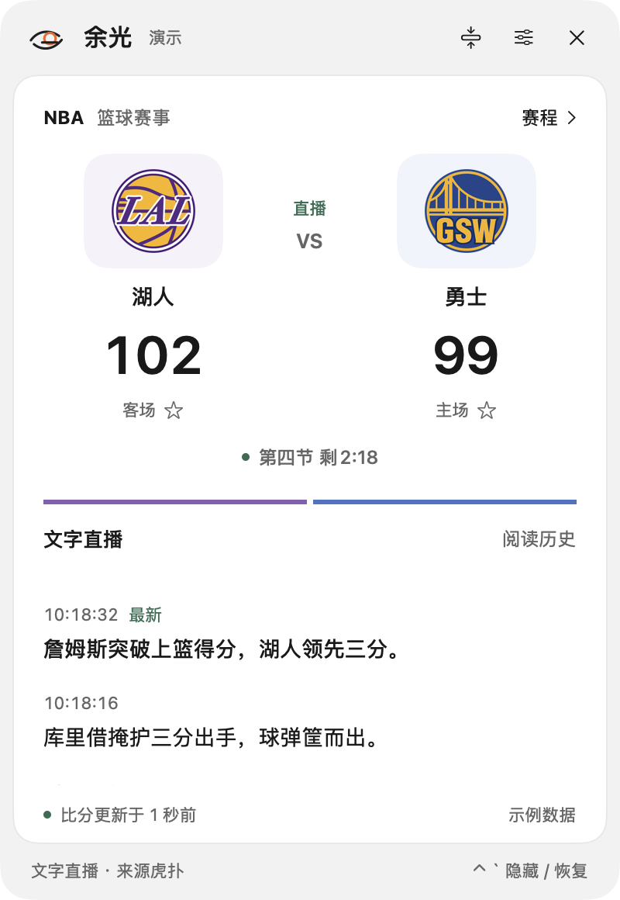
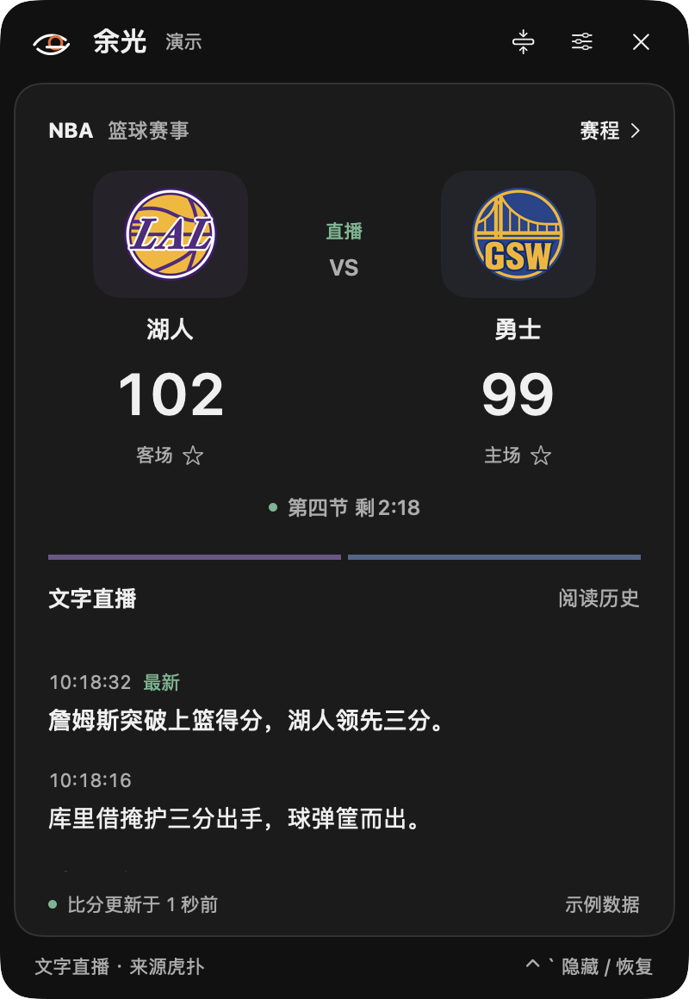
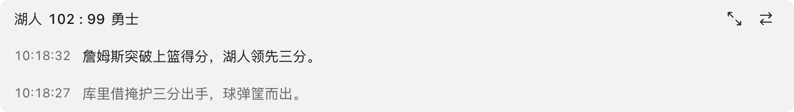

<div align="center">


# 余光 · Yuguang

### 让比赛留在余光里，让灵感留在屏幕上。

**使用余光关注比赛，一边用 AI 编程，一边观看比赛。**

原生 macOS NBA 文字直播助手 · 轻盈悬浮 · 透明文字 · 一键隐现

[界面预览](#界面预览) · [开始使用](#开始使用) · [本地构建](#本地构建) · [平台支持](#平台支持)

</div>

余光诞生于一个很日常的瞬间：AI 正在生成代码，比赛恰好打到关键回合。你想知道发生了什么，却不想把整个桌面交给直播。

于是，我们把球场收进一小行文字里。它可以安静地停在编辑器旁，也可以展开成一扇完整的赛事窗口。在代码、思考与比赛之间，留一点恰到好处的余地。

## 为专注而设计

| 特点 | 体验 |
| --- | --- |
| **一行，也可以更多** | 精简视图支持 1–6 行，包含比分行；多行显示最新解说，按你的桌面空间取舍。 |
| **移开鼠标，只留文字** | 精简视图自动隐去底色、阴影与按钮；移入恢复操作，文字位置保持不变。 |
| **一键隐现** | 默认 `Control + 反引号` 全局隐藏，再按恢复；快捷键可在设置中录制。 |
| **切换比赛，保持轻盈** | 精简视图右上角直接切换比赛、选择日期，无需展开窗口。 |
| **展开，认真看球** | 完整比分、球队队徽、球队配色与文字时间线，支持雾白、炭黑和系统主题。 |
| **你的球队，优先出现** | 按球队筛选、星标关注，关注球队的比赛优先展示。 |
| **纯文字的克制** | 启用简洁模式后不显示球队 Logo，记住偏好，下次启动继续使用。 |
| **融入 macOS** | 原生菜单栏入口、可选菜单栏比分、置顶、窗口位置记忆与边缘吸附。 |

没有声音和通知，没有账号注册，也不因比分更新弹出窗口。比赛在继续，你也可以继续手上的事情。

## 界面预览

<table>
<tr>
<td align="center"><br/>雾白 · 完整赛事窗口</td>
<td align="center"><br/>炭黑 · 夜间阅读</td>
</tr>
</table>

**收起窗口，把比赛放在余光里。**


**需要更多上下文时，多留几行。**



以上为应用原生界面截图，比分与文字均为明确标注的演示数据；正常启动连接实际赛事接口。

## 开始使用

1. 打开余光，在赛程中选择日期、球队，再点击比赛进入文字直播。
2. 拖动窗口顶部的 Logo、标题或空白处移动完整窗口；右上角收起按钮进入精简视图。
3. 精简视图的文字和空白处都能拖动，双击展开；拖动窗口边缘调整宽度。
4. 鼠标移开精简窗口后只保留文字。移回窗口，再点击右上角双向箭头切换比赛。
5. 按 **Control + 反引号（⌃ + &#96;）** 隐藏 / 恢复窗口。关闭按钮只隐藏，退出请使用菜单栏「退出余光」。

通过菜单栏或 `⌘ ,` 打开偏好设置，可调整显示行数、主题、置顶、菜单栏比分与快捷键。精简视图也支持右键选择行数。

「启用简洁模式」会立即进入精简视图并保存启动偏好。临时展开不会关闭该偏好；保持开启时，完整窗口和赛程列表也省略球队 Logo。

阅读历史时，滚动列表或点击「阅读历史」暂停自动跟随；点击「回到最新」恢复。

## 本地构建

需要 **macOS 14 或更高版本、Swift 6 或更高版本**，安装 Xcode 或 Apple Command Line Tools。无第三方运行依赖。

```sh
git clone https://github.com/Aric000/yuguang.git
cd yuguang
bash scripts/build-app.sh
open dist/余光.app
```

产物为 `dist/余光.app` 与 `dist/Yuguang-macOS.zip`，架构跟随构建机器；当前本机验证为 Apple Silicon。构建脚本使用本地 ad-hoc 签名，尚未配置 Developer ID 签名及 Apple 公证。

GitHub Actions 提供 `Build macOS` 工作流：提交代码自动测试和打包，也可在 Actions 页面手动运行；完成后从对应运行的 Artifacts 下载 ZIP。云端构建状态以实际工作流结果为准。

## 下载与发布

安装包位于 [GitHub Releases](https://github.com/Aric000/yuguang/releases)。下载与你的 Mac 架构相符的 `.dmg`，打开后将「余光」拖到 Applications；也可下载 ZIP 解压使用。`arm64` 对应 Apple Silicon，`x86_64` 对应 Intel。

维护者发布步骤：仓库右侧 **Releases → Draft a new release**，创建 `v0.1.0` 这样的版本标签，Target 选择 `main`，填写更新说明后点击 **Publish release**。`Release macOS` 工作流会测试、构建，并上传 DMG、ZIP 与 SHA-256 校验文件到该 Release 的 Assets；请等待 Actions 完成。附件名称会标明构建机器的实际架构，当前流程只构建一种架构。

版本号须采用 `v主版本.次版本.修订号`。打包时会同步应用内部版本。当前产物使用 ad-hoc 签名，尚未完成 Apple 公证，首次运行可能被系统提示无法验证开发者。

## 平台支持

**当前版本仅支持 macOS，尚无 Windows 版本。**

界面与窗口能力基于 SwiftUI、AppKit 和 Carbon。GitHub Actions 能自动构建已有实现，但不能把这些 macOS 系统框架转换成 Windows 应用；仅切换到 Windows runner 无法生成可用的 `.exe`。

后续 Windows 移植可以沿用赛事接口、交互方案和品牌资产，另行实现桌面窗口、透明悬浮、托盘与全局快捷键。网络与数据模型已独立在 `YuguangCore` 中，方便后续复用或迁移。

## 验证与开发

```sh
# 数据模型与协议回归测试
bash scripts/test.sh

# 实际请求赛程、比分、直播参数与文字列表
swift run Yuguang --check-api

# 先退出已运行的余光，再执行原生窗口检查
# 使用演示数据，不连接直播
dist/余光.app/Contents/MacOS/Yuguang --demo --self-test
```

```sh
# 生成实际 SwiftUI 界面的演示截图
dist/余光.app/Contents/MacOS/Yuguang --demo --capture "$PWD/docs/screenshots"
```

| 目录 | 职责 |
| --- | --- |
| `Sources/YuguangCore` | 赛事模型、响应解析与网络服务协议 |
| `Sources/Yuguang` | 状态与轮询、SwiftUI 界面、AppKit 窗口与菜单栏、全局快捷键 |
| `Tests` | 数据与接口契约测试 |
| `scripts` | 打包脚本、应用元信息、原创图标生成源文件 |
| `docs` | 设计记录、界面截图与代码审查报告 |

审查结果见 [代码审查记录](docs/CODE_REVIEW.md)，接口细节见 [数据接入说明](docs/API.md)。

## 数据与隐私

赛程、比分与文字直播来自虎扑相关赛事接口，可能存在延迟；比分与文字分别更新，短暂不同步属于数据源特性。应用保留最近成功的数据，并显示更新时间或连接错误。

消息按服务端顺序去重，每次会话最多保留 500 条。接口只返回近期消息，不承诺补全整场历史。第三方接口可能变化，当前仅接入 NBA 文字直播，不提供视频、评论、登录或其他联赛。

球队关注、外观、快捷键与窗口位置保存在本机 UserDefaults。应用不内置分析统计、不上传偏好；获取赛事数据时直接访问数据服务，缺少本地队徽时可能请求远程图片。

## 致谢

感谢 [hupumoyu-assistant](https://github.com/chenyaoyi88/hupumoyu-assistant) 提供接口调用思路。余光独立实现原生客户端与视觉设计。

「余光之眼」将眼睛、篮球与篮筐融为一个简洁标志，表达随手一瞥，也能跟上比赛。球队队徽与球队标识的权利归各自权利人；本项目与 NBA、各球队及虎扑无官方隶属关系。

---

<div align="center">安静地看一场球。<br/>Build with AI. Follow with Yuguang.</div>
