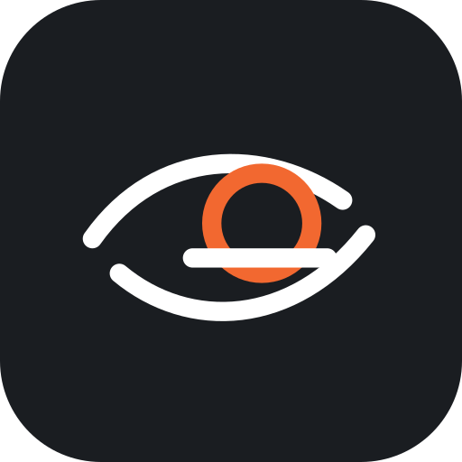

<div align="center">

<h1>余光 · Yuguang</h1>
<p><strong>使用余光关注比赛，一边用 AI 编程，一边观看比赛。</strong></p>
<p>给热爱篮球，也专注创造的你。一扇安静、轻巧的文字直播窗口，让比赛留在视野边缘。</p>
<p><a href="https://github.com/Aric000/yuguang/releases">下载安装包</a> · <a href="docs/API.md">数据接口</a> · <a href="docs/CROSS_PLATFORM.md">双端架构</a></p>
</div>

## 让比赛，恰到好处地出现

余光是一款 NBA 文字直播桌面助手。展开时，它是一张有球队标识、实时比分与比赛动态的精致看板；收起后，它只占屏幕边缘的一小行。代码继续流动，比赛也在继续。

- **文字悬浮，轻盈陪伴**：精简窗口支持 1–6 行；鼠标移开时自动隐去背景、边框和操作按钮，只留下文字。移回即可操作。
- **比分始终在线**：窗口首行与菜单／托盘首行显示当前比赛比分和状态；隐藏窗口仍会继续更新。
- **切换比赛，不打断节奏**：精简窗口右上角的 `⇄` 直接选择比赛和比赛日，无需展开主窗口。
- **一键收起，随时回来**：默认全局快捷键 `Ctrl + \`` 显示／隐藏窗口，支持在偏好设置中修改；快捷键冲突会提示。
- **你的球队，你的配色**：NBA 球队标识、队色、球队筛选与关注；赛程按比赛日浏览。
- **自由安排视野**：置顶、拖动、调整大小、浅色／深色／跟随系统；双击精简窗口展开。直播滚动可暂停，再回到最新。
- **更纯粹的精简模式**：设置中启用后，启动即为精简窗口，并隐藏球队 Logo；临时展开也保留这一偏好。
- **尊重专注**：没有声音、推送或账户注册。网络异常保留已获取内容，界面明确显示连接状态；演示数据仅在显式诊断模式使用。

## 两个平台，各自原生

**一个仓库，两套原生客户端。** macOS 使用 SwiftUI / AppKit，保留系统字体、菜单栏与原生窗口手感；Windows 使用 C# / WPF，使用系统文字渲染、原生托盘与全局快捷键。共用品牌资产、30 支球队图标与数据接口规范。

| 平台 | 下载文件 | 安装方式 |
| --- | --- | --- |
| macOS 14+，Apple Silicon | `Yuguang-版本-macOS-arm64.dmg` 或 `.zip` | 打开 DMG，将「余光」拖到 Applications |
| Windows 10/11，x64 | `Yuguang-版本-windows-x64-setup.exe` | 当前用户安装，无需管理员权限 |
| Windows 10/11，x64 | `Yuguang-版本-windows-x64-portable.exe` | 单文件便携版，双击即可使用，无需单独安装 .NET |

安装包见 [GitHub Releases](https://github.com/Aric000/yuguang/releases)。Mac 当前为本地临时签名，尚未完成 Apple 公证；首次打开可能需要在「系统设置 → 隐私与安全性」中允许打开。Windows 当前未配置代码签名，可能出现来源验证提示。只从本仓库发布页下载；每个平台均提供 SHA-256 校验文件。

## 开始使用

1. 启动余光，从比赛日和球队筛选中选择赛事。
2. 展开窗口看完整文字动态，点击球队名称旁的星标关注球队。
3. 点击 `—` 进入精简窗口；在偏好设置调整行数、主题、置顶和快捷键。
4. 拖动标题区域或精简窗口文字放到合适位置。鼠标移开后，背景自动透明。
5. 点击 `⇄` 换比赛；按 `Ctrl + \`` 隐藏／恢复。退出请使用菜单栏／托盘的「退出余光」。

## 本地开发与打包

```text
yuguang/
├── apps/macos/       SwiftUI / AppKit 原生客户端
├── apps/windows/     WPF 窗口、C# 赛事逻辑、跨平台核心测试
├── shared/assets/    品牌图标、球队 Logo 与颜色目录
├── scripts/          两端测试与打包入口
└── .github/workflows/  自动验证与 Release 发布
```

Mac 需要 macOS、Swift 6+（Xcode 或 Command Line Tools）：

```bash
bash scripts/test-macos.sh
bash scripts/build-macos.sh 0.2.0
apps/macos/dist/余光.app/Contents/MacOS/Yuguang --demo --self-test
```

Windows 需要 .NET 10 SDK；制作安装程序还需要 Inno Setup 6：

```powershell
./scripts/test-windows.ps1
./scripts/build-windows.ps1 -Version 0.2.0
```

安装包输出到仓库根目录 `release/`。Windows 核心逻辑可在 Mac 上执行 `dotnet run --project apps/windows/Yuguang.Tests`；WPF 的实际窗口诊断在 Windows 上运行。`--demo --self-test` 为明确标识的测试数据，不会写入用户偏好。

推送到 `main` 会构建两个平台并保存 Actions Artifacts；发布形如 `v0.2.0` 的 GitHub Release 后，工作流重新测试、打包并自动上传安装包。

## 数据与边界

赛事与文字直播来自虎扑公开客户端接口，默认数秒轮询，并非视频或逐帧直播；第三方接口可能调整，数据可能延迟或不完整。软件不包含任何付费视频流或转播内容，球队标识与赛事数据的权利归各自权利人所有。个人偏好仅保存在本机，应用会向赛事服务发起必要的 HTTPS 请求。
